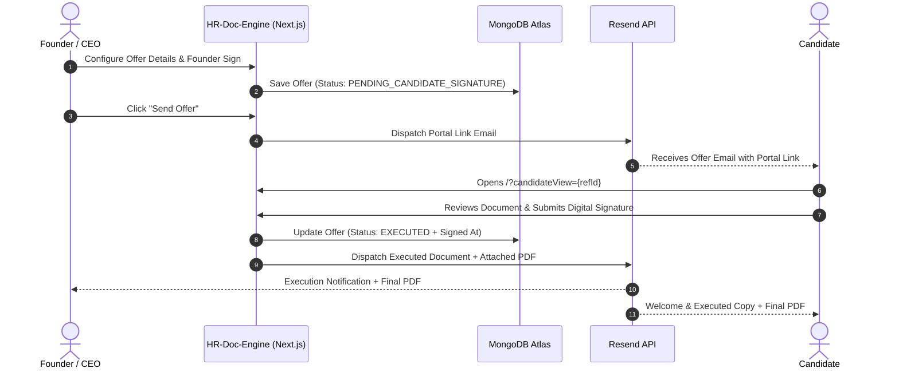

# 📄 HR-Doc-Engine — Creatibuz Studio

<div align="center">


**Next-Generation HR Automation Platform for Contractual Offers, Digital Signatures, and Verified Document Delivery**

[Overview](#-overview) • [Core Features](#-core-features) • [Workflow](#-system-workflow) • [Tech Stack](#-technology-stack) • [Environment Setup](#-environment-variables) • [Getting Started](#-getting-started) • [API Routes](#-api-reference)

---

</div>

## 🌟 Overview

**HR-Doc-Engine** is a specialized HR document lifecycle platform developed for **Creatibuz Studio**. It automates the end-to-end recruitment documentation pipeline: from structured contractual offer letter generation, legally binding dual-signature workflows, and cloud database persistence, to automated transactional email notifications powered by **Resend**.

The system completely eliminates manual PDF editing and scattered communications, delivering a seamless corporate experience for both founders and candidates.

---

## ✨ Core Features

### 📝 Contractual Offer Letter & Work Agreement
- Dynamic, legal-grade contractual agreements tailored for software engineers and corporate team members.
- Configurable terms including probation period, equity share, notice period, and monthly service compensation.
- Automated sequence assignment with formatted reference numbers (`CBS/REF-YY/NNN`) and unique Employee IDs (`CBS-EMP-NNN`).

### ✍️ Dual Digital Signature Workflow
- **Founder Signature**: Pre-rendered or dynamically signed via touch/mouse signature pad, authenticated by company executive seals.
- **Candidate Signature**: Secured candidate portal allowing candidates to sign directly on any mobile device or desktop without account creation.
- Exact signature timestamping with full audit-ready tracking.

### 🚀 Automated Transactional Email Engine (Resend)
- **Phase 1 (Invitation)**: Candidates receive a sleek, modern corporate invitation email featuring a personalized one-click portal access link.
- **Phase 2 (Final Execution)**: Once countersigned by the candidate, the engine automatically attaches the high-resolution finalized PDF and dispatches celebration notices to **both the Founder and Candidate** in real time.

### 🗄️ Resilient Cloud & Local Data Engine
- **MongoDB Atlas Primary**: Cloud persistence storing offer status, candidate details, signature milestones, and compiled PDF data.
- **Fail-Safe Fallback**: Automatic local storage caching ensures zero downtime even during intermittent network drops.
- **Strict Domain Models**: Clean data models (`CompanyDetails`, `CandidateDetails`, `ContractualOfferData`) free of legacy clutter.

### 🖨️ Precision A4 Corporate PDF Engine
- Scaled vector rendering using `jsPDF` and `html2canvas-pro`.
- Multi-page page breaks, official letterhead styling, corporate watermarks, dynamic QR verification codes, and authentic signature blocks.

---

## 🔄 System Workflow



---

## 🛠️ Technology Stack

| Layer | Technology | Purpose |
| :--- | :--- | :--- |
| **Framework** | [Next.js](https://nextjs.org/) (App Router) | Full-stack React framework with SSR and API routes |
| **Language** | [TypeScript](https://www.typescriptlang.org/) | Type-safe domain models and strict linting |
| **Styling** | [Tailwind CSS](https://tailwindcss.com/) | Modern corporate UI styling and responsive layouts |
| **Animation** | [Motion](https://motion.dev/) (Framer Motion) | Micro-interactions, animated transitions, and modal dialogs |
| **Database** | [MongoDB Atlas](https://www.mongodb.com/atlas) + Mongoose | Cloud document database for offer lifecycle storage |
| **Email Delivery** | [Resend](https://resend.com/) | Transactional email delivery with PDF attachments |
| **PDF Generation** | `jsPDF` & `html2canvas-pro` | High-fidelity A4 document compilation |
| **Icons** | [Lucide React](https://lucide.dev/) | Clean corporate UI iconography |

---

## ⚙️ Environment Variables

Create a single `.env` file in the project root with the following configuration:

```env
# ─── Application Configuration ────────────────────────────────────────────────
PORT=3000
NODE_ENV=development
NEXT_PUBLIC_APP_URL=http://localhost:3000

# ─── Resend Transactional Email API ──────────────────────────────────────────
RESEND_API_KEY=re_your_api_key_here
RESEND_FROM_EMAIL=Creatibuz Studio <hr@creatibuzstudio.com>
FOUNDER_EMAIL=founder@creatibuzstudio.com

# ─── MongoDB Atlas Database ──────────────────────────────────────────────────
# Ensure database name is explicitly declared (HR-Doc-Engine_CBS)
MONGODB_URI=mongodb+srv://<username>:<password>@<cluster>.mongodb.net/HR-Doc-Engine_CBS?retryWrites=true&w=majority
```

> [!IMPORTANT]
> The `.env` file is git-ignored by default. Never commit production API keys or database connection strings to public repositories.

---

## 🚀 Getting Started

### 1. Prerequisites
- **Node.js**: `v18.17.0` or higher
- **npm** or **yarn** or **pnpm**
- **MongoDB Atlas** cluster URL

### 2. Installation
```bash
# Clone the repository
git clone https://github.com/creatibuzstudio/HR-Doc-Engine.git

# Navigate into the project directory
cd HR-Doc-Engine

# Install dependencies
npm install
```

### 3. Run the Development Server
```bash
npm run dev
```

Open [http://localhost:3000](http://localhost:3000) in your browser to access the application.

### 4. Build for Production
```bash
npm run build
npm run start
```

---

## 🔌 API Reference

| Endpoint | Method | Description |
| :--- | :--- | :--- |
| `/api/offers` | `POST` | Saves or updates a contractual offer in MongoDB Atlas. |
| `/api/offers?id={ref}` | `GET` | Fetches an agreement by `contractRef` or `_id`. |
| `/api/send-offer-email` | `POST` | Sends the candidate portal invitation link via Resend. |
| `/api/offers/[id]/sign` | `POST` | Submits candidate signature, compiles executed PDF, and triggers celebration emails. |
| `/api/check-id` | `GET` | Verifies whether a given reference number or employee ID already exists. |

---

## 📂 Project Architecture

```txt
src/
├── app/                        # Next.js App Router & API routes
│   ├── api/
│   │   ├── check-id/           # ID validation endpoints
│   │   ├── offers/             # Offer creation, retrieval & signing
│   │   └── send-offer-email/   # Resend email dispatch route
│   ├── layout.tsx              # Root HTML layout and metadata
│   └── page.tsx                # Main application entry point
├── components/                 # Reusable UI components & layouts
├── data/                       # Default configurations & demo constants
│   └── defaults.ts             # Company & candidate baseline details
├── features/                   # Domain-driven feature modules
│   ├── admin/                  # Management dashboard & preview modal
│   ├── auth/                   # Authentication & founder login
│   ├── candidate-portal/       # Candidate signing interface
│   ├── doc-select/             # Document type selector
│   ├── document-preview/       # Live A4 document templates & previewers
│   ├── email/                  # Email previewers & dispatch modals
│   └── wizard/                 # Multi-step offer creation wizard
├── lib/                        # Core utilities & service providers
│   ├── agreementStore.ts       # MongoDB & local store abstraction layer
│   ├── emailConfig.ts          # Resend client initializer
│   ├── emailOfferTemplates.ts   # Responsive HTML email templates
│   ├── idGenerators.ts         # CBS/REF & CBS-EMP sequence generators
│   └── mongodb.ts              # Mongoose connection pool manager
└── types/                      # TypeScript interface declarations
    └── index.ts                # Domain models & document state types
```

---

## 🏢 Organization

**Creatibuz Studio**  
*Building cutting-edge digital experiences and enterprise tools.*

* **Website**: [www.creatibuzstudio.com](https://www.creatibuzstudio.com)
* **Email**: [info@creatibuzstudio.com](mailto:info@creatibuzstudio.com)
* **Office**: Delduar Road, Tangail Shadar, Dhaka, Bangladesh

---

## 📄 License

This repository and its codebase are **proprietary and confidential** to **Creatibuz Studio**. Unauthorized copying, redistribution, or modification is strictly prohibited.
